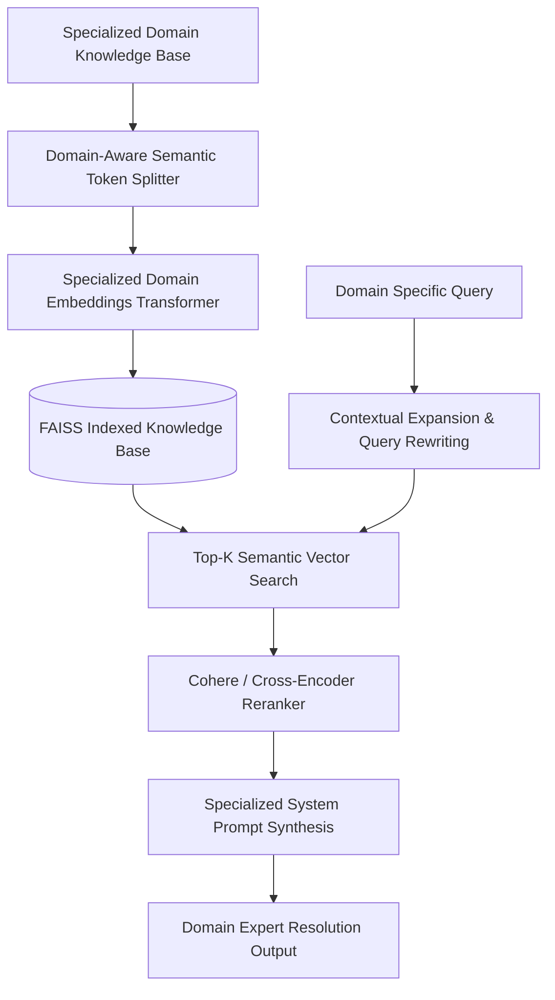

<div align="center">

  <!-- NATIVE ANIMATED CYBER BANNER -->
  

  <br/>

  <!-- ANIMATED TYPING SVG -->
  

  <br/>

  <!-- TECH BADGES -->
  <p align="center">
    
    
    
    
    
  </p>

</div>

---

### 🌟 System Overview

**Domain-Focused Retrieval-Augmented Generation (RAG) System** is a specialized framework optimized for high-complexity vertical domains (healthcare, legal, technical architecture). It leverages custom chunking strategies, domain vocabulary embeddings, and contextual rerankers to minimize false positives.

---

### 🔬 Operational Architecture & Data Pipeline Flow



---

### 🚀 Key Capabilities & Features

- **🔬 Domain-Adapted Embeddings:** Fine-tuned representation vectors capturing intricate technical vocabulary and jargon.
- **🎯 Contextual Query Rewriting:** Expands acronyms and ambiguous prompts into comprehensive retrieval queries.
- **📊 Hierarchical Chunking:** Preserves section headers, table structures, and footnotes for coherent answers.
- **⚡ Millisecond FAISS Retrieval:** Ultra-fast nearest-neighbor search scaling to millions of document segments.

---

### ⚡ Quickstart & Execution

```bash
# 1. Clone & enter
git clone https://github.com/Akshay-Notfound/RAG-Domain-Expert-.git
cd RAG-Domain-Expert-

# 2. Install dependencies
pip install -r requirements.txt

# 3. Ingest documents & run evaluation
python ingest.py
python query.py
```

---

### 👤 Author & Architecture

**Akshay Shivaji Rathod**  
*Data & AI Engineer*  
* 🌐 **Portfolio:** [akshay-notfound.vercel.app](https://akshay-notfound.vercel.app)  
* 💼 **LinkedIn:** [linkedin.com/in/akshay-rathod-aaab52206](https://www.linkedin.com/in/akshay-rathod-aaab52206/)  
* 🐙 **GitHub:** [@Akshay-Notfound](https://github.com/Akshay-Notfound)  

---

<div align="center">
  <sub>Licensed under the MIT License. Designed for scalability, intelligence, and performance.</sub>
</div>
